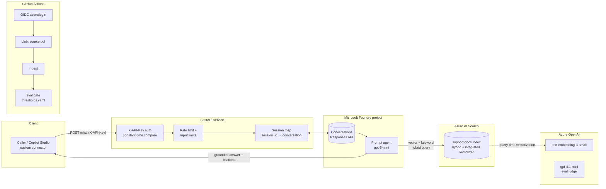

# 3040-support-agent

[](https://github.com/tariqkistan/3040-support-agent/actions/workflows/ci.yml)
[](https://www.python.org/)

A technical support agent built on **Microsoft Foundry** (Azure AI), grounded in
a real technical PDF, secured without hardcoded secrets, and gated by an
evaluation suite in CI.

Ask it a question about the source document and it answers only from the indexed
manual, citing `Sources: <section> — p. <page>` — or refuses when the answer
isn't in the doc.

> **Note on the source document:** the reference PDF is **not included** in this
> repo (copyright; `data/docs/*.pdf` is gitignored). The project works with any
> technical PDF — drop one at `data/docs/source.pdf` and run `inspect_pdf.py`
> then `ingest.py`.

## Architecture



All Azure access uses `DefaultAzureCredential` (Entra ID). There are **no Azure
keys in code, config, or CI** — the only secret anywhere is the API's own
`X-API-Key`.

## Features

- **Grounded chat API** — `POST /chat` with `session_id` → Foundry
  conversations; answers cite section + page; typed `sources[]` in the response
- **Foundry prompt agent** — Azure AI Search tool with hybrid (vector + keyword)
  retrieval; instructions enforce answer-only-from-index + refusal
- **Structure-aware ingest** — font/layout analysis detects headings, tables,
  and numbered procedures; ~800-token chunks with ~100 overlap; tables and
  steps are never split mid-item; idempotent re-ingest
- **Copilot-ready OpenAPI** — operationIds `chatWithSupportAgent` /
  `healthCheck` and an `apiKey` security scheme, so the spec imports cleanly as
  a custom connector
- **Auth & abuse controls** — constant-time API-key compare (fails closed),
  per-IP rate limiting, message length limits
- **Eval gate** — 30-case dataset; metrics: groundedness + relevance (LLM
  judge), citation accuracy, refusal rate; `thresholds.yaml` gates CI
- **CI** — lint + tests on every change; eval job uses OIDC `azure/login` (no
  stored secrets), fetches the PDF from a private blob, re-ingests, runs the
  gate, and uploads `results.json` as an artifact

## Project layout

```
app/            FastAPI service (config, auth, agent, main)
ingest/         inspect_pdf.py, chunking.py, ingest.py
evals/          dataset.jsonl, thresholds.yaml, run_evals.py
tests/          unit + request-validation + OpenAPI tests
docs/LEARNING.md  per-stage "why this design" notes
.github/workflows/ci.yml
```

## Prerequisites

- Python 3.11+
- An Azure subscription with:
  - a **Microsoft Foundry** project (`https://<resource>.services.ai.azure.com/api/projects/<project>`)
  - a **chat model** (instant models like `gpt-5-mini` work without a deployment in supported regions)
  - an **embedding deployment** on the resource's Azure OpenAI endpoint (e.g. `text-embedding-3-small`)
  - an **Azure AI Search** service (free tier works — no semantic ranker; set `SEARCH_QUERY_TYPE=vector_simple_hybrid`)
  - an **eval judge deployment** — a *non-reasoning* model such as `gpt-4.1-mini`
  - an **Azure AI Search connection** on the Foundry project (AAD auth)

### RBAC roles required

| Identity | Role | Scope |
|---|---|---|
| You / CI OIDC app | `Azure AI User` (or `Azure AI Project Manager`) | Foundry account |
| You / CI OIDC app | `Cognitive Services OpenAI User` | Foundry account (embeddings + judge) |
| You / CI OIDC app | `Search Index Data Contributor` | Search service |
| You / CI OIDC app | `Search Service Contributor` | Search service (index create) |
| Foundry project managed identity | `Search Index Data Reader` | Search service |
| Search service managed identity | `Cognitive Services OpenAI User` | Foundry account (index vectorizer) |
| CI OIDC app | `Storage Blob Data Reader` | PDF blob container |

## Quickstart

```bash
python3.11 -m venv .venv && source .venv/bin/activate
pip install -r requirements-dev.txt

cp .env.example .env     # fill in endpoints + deployment names (no Azure keys)
az login                 # local auth for DefaultAzureCredential

# 1. Inspect the doc
python -m ingest.inspect_pdf           # scanned? it tells you what to do

# 2. Build the index + upload chunks (idempotent)
python -m ingest.ingest

# 3. Run the API
uvicorn app.main:app --reload

# 4. Chat
curl -X POST localhost:8000/chat \
  -H "X-API-Key: $APP_API_KEY" -H "Content-Type: application/json" \
  -d '{"message": "How do I clean the focal lens?", "session_id": "demo"}'

# 5. Tests + evals
ruff check . && pytest -q
python -m evals.run_evals              # writes evals/results.json, gates on thresholds
```

## API

| Endpoint | Auth | Description |
|---|---|---|
| `GET /health` | none | Liveness (`healthCheck`) |
| `POST /chat` | `X-API-Key` | `{message, session_id?}` → `{answer, sources[], session_id}` (`chatWithSupportAgent`) |

`session_id` maps to a Foundry conversation, so follow-up questions keep context.

## Evaluation gate

`python -m evals.run_evals` runs the agent over 30 cases (15 direct, 5 table,
5 procedural, 5 out-of-scope), scores each, and exits non-zero below any
threshold in `evals/thresholds.yaml`:

| Metric | Floor | How |
|---|---|---|
| groundedness | 3.5 | LLM judge (azure-ai-evaluation) |
| relevance | 3.5 | LLM judge |
| citation_accuracy | 0.60 | cited page within ±2 of expected |
| refusal_rate | 0.80 | out-of-scope cases refused |

Per-category breakdowns land in `evals/results.json` (gitignored, uploaded as a
CI artifact).

## CI setup (one-time)

The eval job in `.github/workflows/ci.yml` needs:

1. **A Microsoft Entra app registration with a federated credential** (GitHub
   OIDC) for this repo:

   ```bash
   az ad app create --display-name gh-3040-support-agent
   APP_ID=$(az ad app list --display-name gh-3040-support-agent --query "[0].appId" -o tsv)
   az ad sp create --id $APP_ID
   az ad app federated-credential create --id $APP_ID --parameters '{
     "name": "main", "issuer": "https://token.actions.githubusercontent.com",
     "subject": "repo:<owner>/3040-support-agent:ref:refs/heads/main",
     "audiences": ["api://AzureADTokenExchange"]}'
   # add another federated credential for pull_request if you gate PRs
   ```

   Assign the RBAC roles from the table above to that service principal.

2. **A private blob container holding the source PDF** (same or another storage
   account), with `Storage Blob Data Reader` for the OIDC principal.

3. **Repo settings:**
   - *Secrets*: `AZURE_CLIENT_ID`, `AZURE_TENANT_ID`, `AZURE_SUBSCRIPTION_ID`,
     `APP_API_KEY`
   - *Variables*: every endpoint/deployment name in `.env.example`, plus
     `PDF_STORAGE_ACCOUNT`, `PDF_STORAGE_CONTAINER`, `PDF_BLOB_NAME`

The `test` job runs everywhere; the `evals` job runs on pushes to `main`, PRs,
and manual dispatch.

## Scope and limitations

- **Single-document agent.** Grounding is one index of one manual. Multi-doc
  routing, doc versioning, and user-level memory are out of scope.
- **Sessions live in process memory.** `session_id` → conversation mapping is an
  in-process dict — fine for a demo, replaced by a store for production.
- **Eval scores are indicative, not absolute.** LLM judges are noisy; floors in
  `thresholds.yaml` come from the baseline run, not a universal quality bar.
- **Free-tier search** has no semantic ranker; `vector_semantic_hybrid` is one
  config flip away on a paid tier.
- **The API key is a demo control** — one shared key, not per-user auth.

## Design notes

See [docs/LEARNING.md](docs/LEARNING.md) for a per-stage "why this design"
walkthrough (chunking, the index-side vectorizer, conversations vs threads, the
non-reasoning judge, OIDC, and more).
